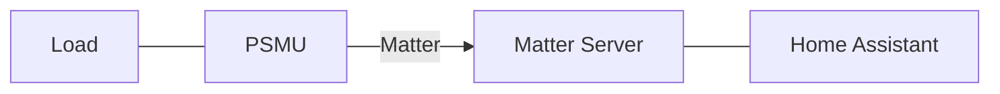

# Architecture – PSMU

**Power Switch and Measurement Unit (PSMU)**

> Status: Utkast
> Version: 0.1
> Ansvarig: [ ]
> Senast uppdaterad: 2026-11-04
> Relaterade: [`specification.md`](specification.md),
> [`decisions.md`](../project/decisions.md),
> [`glossary.md`](../reference/glossary.md)

> **Äger:** systemöversikt, komponenter, datamodell, Matter-integration och
> byggmiljö.
> **Läs vid behov:** [`specification.md`](specification.md) för beteende och
> [`../reference/external/matter-1.6.1/INDEX.md`](../reference/external/matter-1.6.1/INDEX.md)
> för Matter-utdragen (sök där, läs inte hela textfilerna).

## 1. Syfte

Det här dokumentet beskriver mjukvarans övergripande uppbyggnad: komponenter,
ansvarsgränser, dataflöden och integrationen med Matter och Home Assistant.
Detaljerat beteende – driftlägen, knapp, lysdioder och mätning – finns i
[`specification.md`](specification.md).

Dokumentet beskriver **avsedd arkitektur**. Exakt implementation, mjukvaruversion
och hårdvarutarget är inte fastställda ännu.

## 2. Systemöversikt

PSMU är en Matter-enhet som styr en `Output` och mäter den anslutna `Load`.
Enheten kan användas fristående i `LOCAL` eller via en `Fabric` i Home Assistant.

PSMU ansvarar för:

- att växla `Output State` (`ON`/`OFF`),
- att mäta spänning, ström och effekt i `OPERATIONAL`,
- att hantera `Operation Mode` och lokal manövrering,
- att lagra den konfiguration och det tillstånd som krävs vid `Power-up`.

Home Assistant och `Matter Server` ligger utanför PSMU och ansvarar för
`Commissioning`, automationer och användargränssnitt.

## 3. Komponenter

Datamodellen nedan använder fyra komponentbeteckningar. Deras fullständiga namn
och ansvarsgränser är inte fastställda (`TBD-19`); tabellen är en preliminär
tolkning utifrån vilka data respektive komponent äger.

| Komponent | Preliminärt ansvar | Äger data |
|---|---|---|
| **`PSMD`** | Tidsstämplar och sampeldata från mätningen. | `timestamp`, `nsamp` |
| **`MDCB`** | Enhetsidentitet, konfiguration och metadata. | `mac_address`, `friendly_name`, `location`, `geolocation`, `mdcb_firmware` |
| **`MDB`** | Utgångstillstånd och beräknade mätvärden. | `ac_switch`, `vac`, `iac`, `papp`, `pact`, `preact`, `phase_delay`, `frequency`, `energy`, `mdb_firmware`, `mdb_app_id` |
| **`DPS`** | Persistent lagring av data som ska överleva `Power-up`. | `mdb_firmware` |

> **Att undersöka:** komponenternas ansvar och gränssnitt behöver bekräftas innan
> de kan användas som arkitekturbegrepp i krav och tester (`TBD-19`).

## 4. Datamodell

Tabellen är den preliminära datamodellen. Fältnamn, typer och skalning behöver
bekräftas (`TBD-20`).

| Name | Editable | Origin | Storage | Data type |
|---|---|---|---|---|
| timestamp | no | PSMD | PSMD | int |
| mac_address | no | MDCB | MDCB | string |
| ac_switch | yes | MDB | MDB | bool |
| nsamp | no | PSMD | PSMD | int64 |
| vac | no | MDB | MDB Calculated | int64 |
| iac | no | MDB | MDB Calculated | int64 |
| papp | no | MDB | MDB Calculated | int64 |
| pact | no | MDB | MDB Calculated | int64 |
| preact | no | MDB | MDB Calculated | int64 |
| phase_delay | no | MDB | MDB Calculated | int64 |
| frequency | no | MDB | MDB Calculated | int64 |
| energy | no | MDB | MDB Calculated | int64 |
| friendly_name | yes | MDCB | MDCB | String |
| mdb_firmware | no | MDB | DPS | `byte[8]`, `a.b.c => uint16.uint16.uint32` |
| mdcb_firmware | no | MDCB | MDCB | `byte[8]`, `a.b.c => uint16.uint16.uint32` |
| location | yes | MDCB | MDCB | String |
| geolocation | yes | MDCB | MDCB | String |
| mdb_app_id | no | MDB | MDB | String |

`Editable = yes` innebär att värdet kan ändras via gränssnittet. `Origin` anger
var värdet skapas och `Storage` var det lagras.

## 5. Matter och Home Assistant

- `Commissioning` lägger PSMU i en `Fabric` och gör enheten styrbar från Home
  Assistant.
- `Operation Mode` och övergångar specificeras i
  [`specification.md`](specification.md).
- Mätning sker endast i `OPERATIONAL`; vilka kluster och attribut som exponeras
  är inte fastställt (`TBD-10`, `TBD-11`).
- `Pairing Timeout`, `Commissioning Timeout`, `Reconnect` och hantering av flera
  `Fabric` är öppna frågor (`TBD-01`, `TBD-02`, `TBD-06`, `TBD-07`, `TBD-09`).

## 6. Nätverk och provisionering

Hur PSMU får Wi-Fi-uppgifter, hur återanslutning sker och hur enheten beter sig
när Home Assistant inte nås är inte fastställt (`TBD-05`, `TBD-06`, `TBD-07`).

## 7. Byggmiljö och körtid

- Mjukvaran byggs med **ESP-IDF**. Projektet i detta repository innehåller endast
  dokumentation, inte firmware-källkod.
- Hårdvarutarget, ESP-IDF-version och byggkonfiguration är inte fastställda.
- Firmware- och applikationsversioner lagras enligt datamodellen ovan.

## 8. Säkerhet och uppdatering

Matter-attestering, nyckelhantering, säker lagring och eventuell OTA-uppdatering
är ännu inte utrett. Inga krav eller lösningar är fastställda.

## 9. Öppna frågor

Samtliga öppna frågor och fattade beslut finns i
[`decisions.md`](../project/decisions.md).
